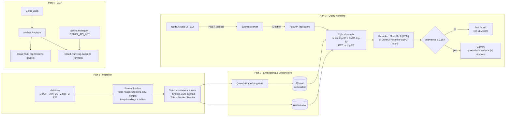

# Police Complaints RAG Assistant

A retrieval-augmented generation (RAG) assistant that answers questions about **filing and escalating police complaints in India**. It covers FIRs, Zero FIR and e-FIR, BNSS Section 173, D.K. Basu arrest safeguards, NHRC custodial-death rules and Police Complaints Authorities. Every answer is grounded in **10 documents in 4 formats** (PDF, HTML, Markdown, TXT) and carries **clickable citations**.

| Layer | Choice |
|---|---|
| Chunking | Structure-aware recursive, ~400 tokens, 15% overlap, contextual headers |
| Embeddings | `Qwen3-Embedding-0.6B` (free, Apache-2.0, CPU); swap to 4B or 8B with one env var |
| Vector DB | **Qdrant**, embedded and baked into the container (Qdrant Cloud free tier optional) |
| Retrieval | Hybrid: dense (Qdrant) + BM25, fused with Reciprocal Rank Fusion |
| Reranker | `ms-marco-MiniLM-L6-v2` cross-encoder (fast on CPU, default) or `Qwen3-Reranker-0.6B` (best quality, GPU), plus a relevance gate for out-of-scope questions |
| LLM | **Gemini**: `gemini-3.5-flash-lite` for the demo, `gemini-4-argon` for best quality |
| Frontend | **Node.js** (Express web UI + CLI) |
| Cloud | **GCP**: Cloud Run ×2, Cloud Build, Artifact Registry, Secret Manager |

The reasoning for every choice, with benchmarks and the alternatives considered, is in **[docs/DESIGN_DECISIONS.md](docs/DESIGN_DECISIONS.md)**.

---

## Architecture



## The four parts

The project was built and committed in four parts. Each one is a separate commit.

| Part | What | Where |
|---|---|---|
| **1. Data & ingestion** | 10-document corpus, PDF/HTML/MD/TXT loaders with noise removal, structure-aware chunker | `data/`, `backend/rag/loaders.py`, `backend/rag/chunker.py`, `backend/scripts/ingest.py` |
| **2. Embedding & vector store** | Qwen3 embedder, Qdrant store (embedded or remote), index builder | `backend/rag/embeddings.py`, `backend/rag/vectorstore.py`, `backend/scripts/build_index.py` |
| **3. Query handling** | Hybrid retrieval + RRF, cross-encoder / Qwen3 reranker, Gemini generator, FastAPI, Node.js UI + CLI | `backend/rag/{retriever,reranker,generator,pipeline}.py`, `backend/api.py`, `frontend/` |
| **4. Cloud & docs** | Dockerfiles, Cloud Build, GCP setup scripts, CI, evaluation, documentation | `backend/Dockerfile`, `frontend/Dockerfile`, `deploy/`, `eval/`, `.github/`, `docs/` |

---

## Run it locally

**Prerequisites:** Python 3.11+, Node.js 20+, and a [Gemini API key](https://aistudio.google.com/apikey).

```bash
git clone https://github.com/Prani16/police-complaints-rag.git
cd police-complaints-rag
cp .env.example .env            # then paste your GEMINI_API_KEY into .env

# backend
cd backend
python -m venv .venv && source .venv/bin/activate      # Windows: .venv\Scripts\activate
pip install torch --extra-index-url https://download.pytorch.org/whl/cpu
pip install -r requirements.txt
python -m scripts.ingest        # Part 1 -> data/processed/chunks.jsonl
python -m scripts.build_index   # Part 2 -> data/qdrant/ (downloads Qwen3 models on first run)
uvicorn api:app --port 8080     # Part 3 API

# frontend (second terminal)
cd frontend
npm install
npm start                       # web UI on http://localhost:3000
node cli.js "What can I do if the police refuse to register my FIR?"
node cli.js                     # interactive mode
```

No GPU and no API key yet? `EMBED_BACKEND=hash RERANK_BACKEND=none` runs the whole stack offline with a lexical stand-in embedder. Without `GEMINI_API_KEY`, the API returns the top passages instead of a generated answer.

### Tests

```bash
cd backend && pytest -q          # 15 tests, fully offline (no models, no Gemini)
cd frontend && npm test          # 4 tests against a fake backend
```

### Evaluation

```bash
cd backend
python -m scripts.eval              # Hit@1, Hit@5, MRR: dense vs BM25 vs hybrid vs hybrid+rerank
python -m scripts.eval --generate   # + end-to-end answer accuracy with Gemini
```

`eval/questions.jsonl` has 16 in-scope questions with expected source documents and key phrases, plus 2 out-of-scope questions that must be refused. With the offline stand-in embedder, hybrid retrieval already beats either retriever alone:

| Strategy | Hit@1 | Hit@5 | MRR |
|---|---|---|---|
| dense only | 0.81 | 0.94 | 0.885 |
| BM25 only | 0.81 | 1.00 | 0.887 |
| **hybrid (RRF)** | **0.94** | **1.00** | **0.969** |

Run it with the real Qwen3 models to get the numbers for your write-up.

---

## Deploy to GCP

```bash
gcloud auth login
PROJECT_ID=<your-project> ./deploy/setup_gcp.sh    # one time: APIs, Artifact Registry, service accounts, Gemini secret
PROJECT_ID=<your-project> ./deploy/deploy.sh       # Cloud Build -> both images -> Cloud Run
```

Options: `REGION` (default `asia-south1`, Mumbai), `GEMINI_MODEL=gemini-4-argon` for best quality, and `MIN_INSTANCES=1` on demo day to avoid cold starts.

What gets deployed:
- **rag-backend** (private): FastAPI, with models and Qdrant index baked into the image. Runs on 2 vCPU, 8 GiB, with startup CPU boost and scale-to-zero. `GEMINI_API_KEY` is read from Secret Manager.
- **rag-frontend** (public): the Node.js UI. It calls the backend with a Google-signed ID token, so nobody else can reach the backend directly.

## Upload your own documents

You can add files to the index from the web UI without rebuilding anything:

1. Click **Upload a document**, or drag a file onto the upload box. PDF, HTML, Markdown and TXT files up to 10 MB are supported.
2. The file runs through the same pipeline as the built-in corpus: load, clean, structure-aware chunking, Qwen3 embedding, then Qdrant plus BM25. It's searchable as soon as the upload finishes.
3. After an upload, **Search in** switches to **My uploads only**, so answers come only from your files. Switch back to **All documents** to search everything.
4. Remove an upload with the **×** on its chip.

From the CLI:
```bash
node cli.js upload path/to/notes.pdf
node cli.js --uploads "What does my file say about deadlines?"
```

Uploaded files are stored in `data/uploads/` (git-ignored) and their chunks in `data/processed/chunks.jsonl`, so they survive a backend restart. Re-uploading a file with the same name replaces it. Scanned PDFs with no text layer are rejected, because there's no OCR.

**On Cloud Run**, uploads live only on that container's disk. They disappear when the instance restarts, and they aren't shared between instances. For persistent shared uploads, set `QDRANT_URL` to Qdrant Cloud and store the files in a Cloud Storage bucket.

## API

| Method | Path | Body / response |
|---|---|---|
| `GET` | `/health` | `{status, chunks, vectors}` |
| `GET` | `/api/info` | models, vector store, documents with chunk counts |
| `POST` | `/api/query` | `{"question": "...", "top_k": 5, "scope": "all" \| "uploads"}` → `{answer, found, sources[n, cited, title, section, pages, text, rerank_score], models, timings_ms}` |
| `POST` | `/api/upload` | raw file bytes, URL-encoded name in `X-Filename` → `{doc_id, title, type, chunks, seconds}` |
| `GET` | `/api/documents` | every indexed document, with `uploaded: true/false` |
| `DELETE` | `/api/documents/{doc_id}` | remove an uploaded document (built-in documents can't be removed) |

The Node server exposes the same data at `/api/ask`, `/api/info`, `/api/upload` and `/api/documents` for the browser.

## Configuration

Everything is set by environment variables. See [`.env.example`](.env.example). The most useful ones:

| Variable | Default | Notes |
|---|---|---|
| `GEMINI_MODEL` | `gemini-3.5-flash-lite` | `gemini-4-argon` for best quality |
| `EMBED_MODEL` | `Qwen/Qwen3-Embedding-0.6B` | `…-4B` / `…-8B` on a GPU (rebuild the index after changing) |
| `RERANK_BACKEND` / `RERANK_MODEL` | `fast` / *(empty → backend default)* | `qwen` for best quality on a GPU, `bge`, or `none` |
| `QDRANT_URL` | *(empty → embedded)* | set for Qdrant Cloud |
| `CHUNK_MAX_TOKENS` / `CHUNK_OVERLAP_TOKENS` | `400` / `60` | rerun ingest and build_index after changing |
| `MIN_RELEVANCE` | `0.15` | reranker threshold for "not found" |

---

## Challenges and how they were resolved

| Challenge | Resolution |
|---|---|
| Official PDFs couldn't be downloaded from the build sandbox | Compiled summary notes from the public sources ([data/SOURCES.md](data/SOURCES.md)) and rendered them as real multi-page PDFs with running headers, so the PDF loader still faces realistic input. The loaders are format-driven, so real files drop straight in. |
| PDF running headers and page numbers repeated in every chunk | Detect lines that repeat at the top or bottom of at least 60% of pages (digits normalised) and drop them. |
| PDF titles that wrap onto two lines became two separate headings | Join consecutive heading lines of the same font-size level. |
| Short sections (e.g. a 50-token "Later modification") made weak, context-free chunks | Merge fragments under 80 tokens into a neighbour, keeping the sub-heading inline as `[Heading]`. |
| Dense search blurred exact legal identifiers (`173(3)`, `41D`, `CCTNS`) | BM25 alongside dense search, fused with RRF. The tokenizer keeps alphanumeric section numbers. |
| The LLM tried to answer off-topic questions | Relevance gate on the reranker score: below 0.15, return "not found" without calling Gemini. |
| Cold starts on Cloud Run (two 0.6B models on CPU) | Download models and build the index at Docker build time, use startup CPU boost and warm models at app startup, and set `MIN_INSTANCES=1` for the demo. |
| Qwen3-Reranker-0.6B took ~490 s per question on a laptop CPU | Load models in float32 (the checkpoints are bf16, which is slow on most CPUs), compute only last-token logits, rerank 10 passages capped at 512 tokens, and add a 22M-parameter MiniLM cross-encoder as the default CPU reranker. Qwen stays one env var away for GPUs. |
| Adding uploaded files without re-indexing everything | Uploads go through the same loader and chunker, are upserted into the live Qdrant collection, and the in-memory BM25 index is rebuilt and swapped in atomically under a lock, so queries running at the same time never see a half-updated index. Search scope uses a Qdrant payload filter on `doc_id`. |
| Embedded Qdrant holds a file lock | One uvicorn worker per container (scale with Cloud Run instances), and close and reset the cached client after indexing. |
| Calling a private Cloud Run backend from Node | Fetch an ID token from the metadata server, cache it for 50 minutes, and grant `run.invoker` only to the frontend's service account. |
| Tests needed models and network access | A hashing embedder test double plus a hermetic `conftest.py` that builds a temporary index, so CI runs in seconds. |

## Learnings

- **Retrieval quality matters more than LLM size.** Once the right 5 passages arrive, the cheapest Flash-Lite model answers well. Most of the effort belongs in chunking, hybrid search and reranking.
- **Chunk on structure, not on character count.** Keeping each section together, with its heading in the embedded text, made citations point to meaningful sections.
- **A reranker is not automatically better.** In Qwen's own evaluation, BGE, jina and gte rerankers scored below the no-reranker baseline on MTEB-R. Check the numbers for your pipeline.
- **Hybrid search is cheap insurance.** BM25 costs nothing and catches the exact identifiers that dense models miss.
- **Build the eval set early.** Sixteen questions with expected documents were enough to compare four retrieval strategies in seconds.
- **Make every model a config value.** Swapping Gemini, embedding or reranker models is an env var change, which is handy when hackathon rules or quotas change.

## Project structure

```
police-complaints-rag/
├── backend/
│   ├── rag/                   config, schema, loaders, chunker, embeddings,
│   │                          vectorstore, retriever, reranker, generator, pipeline
│   ├── scripts/               ingest.py · build_index.py · eval.py
│   ├── tests/                 Part 1–3 tests (offline)
│   ├── api.py                 FastAPI app
│   ├── Dockerfile
│   └── requirements.txt
├── frontend/                  Node.js: server.js · cli.js · backend-client.js · public/ · test/
├── data/raw/                  the 10 source documents · data/SOURCES.md
├── deploy/                    setup_gcp.sh · deploy.sh · cloudbuild.yaml
├── eval/questions.jsonl
├── docs/DESIGN_DECISIONS.md
└── .github/workflows/ci.yml
```

---

*General information for a learning project. This is not legal advice.*
